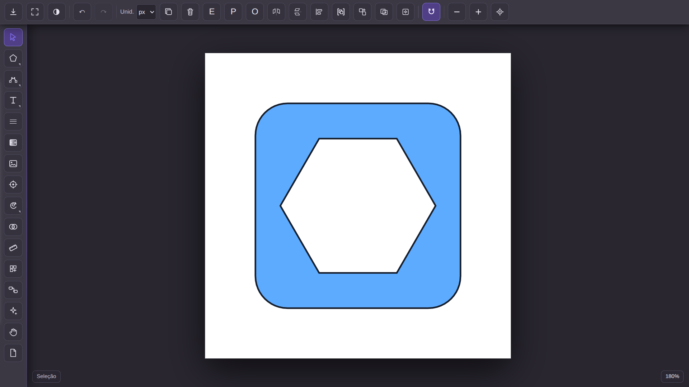
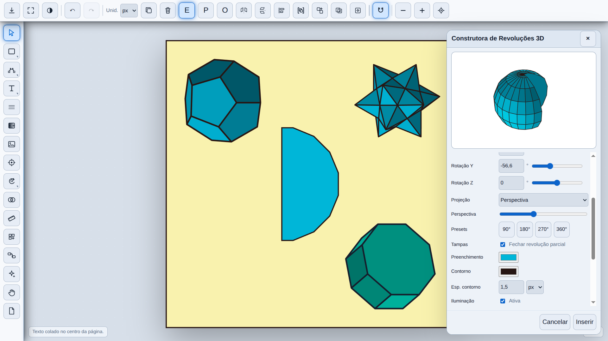
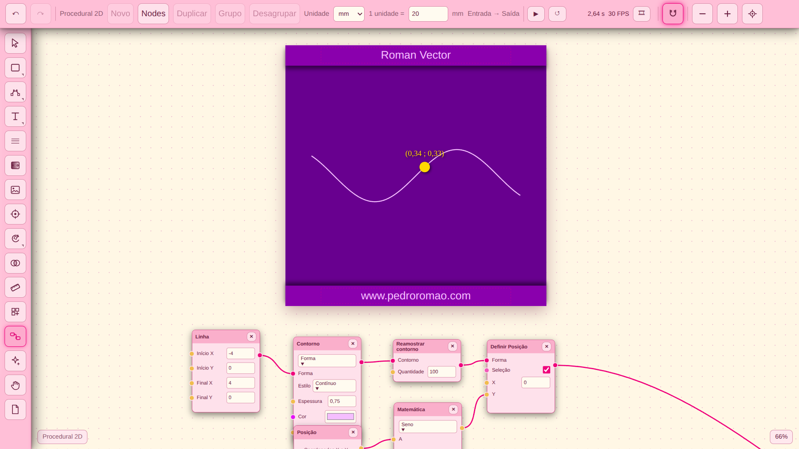
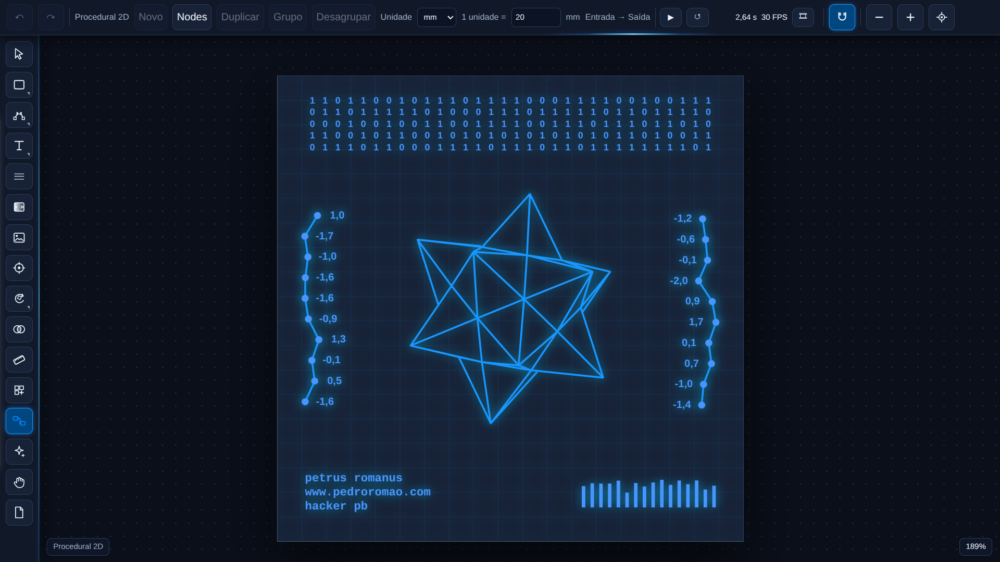

# Roman Vector

**Editor vetorial para desenho, matemática, geometria e criação procedural no navegador.**

### [🚀 Abrir Roman Vector](https://pedroromaobatista.github.io/roman-vector/)

*Sem instalação — abra diretamente no navegador.*

## Conheça o editor

O **Roman Vector** reúne ferramentas de desenho vetorial, construções geométricas, recursos matemáticos, visualização 3D e criação procedural em uma interface com diferentes temas visuais.

## Galeria

### Desenho e edição vetorial

Criação e edição de formas geométricas, com barra de ferramentas e área de desenho.

### Construções tridimensionais

Exemplos de sólidos e painel da **Construtora de Revoluções 3D**, com opções de rotação, projeção e aparência.

### Procedural 2D — nodes e matemática

Construção de curvas e formas por meio de nodes conectados e operações matemáticas.

### Composição vetorial em estilo futurista

Exemplo de composição gráfica criada no editor, demonstrando possibilidades de personalização visual.

## Funcionalidades

- **Desenho vetorial:** formas, curvas, contornos, preenchimentos e edição de objetos.
- **Geometria e matemática:** construções geométricas, ferramentas de medição, plano cartesiano e gráficos estatísticos.
- **Recursos 3D:** poliedros, extrusão e revolução.
- **Procedural 2D:** nodes, operações matemáticas, instâncias e animações.
- **Personalização:** temas visuais e efeitos gráficos.
- **Exportação:** opções para salvar projetos e exportar desenhos.

## Acesso e atualizações

Use o aplicativo em: **https://pedroromaobatista.github.io/roman-vector/**

Consulte a seção **Releases** deste repositório para acompanhar as versões publicadas e suas novidades.

---

**Roman Vector — Pedro Romão Batista**

